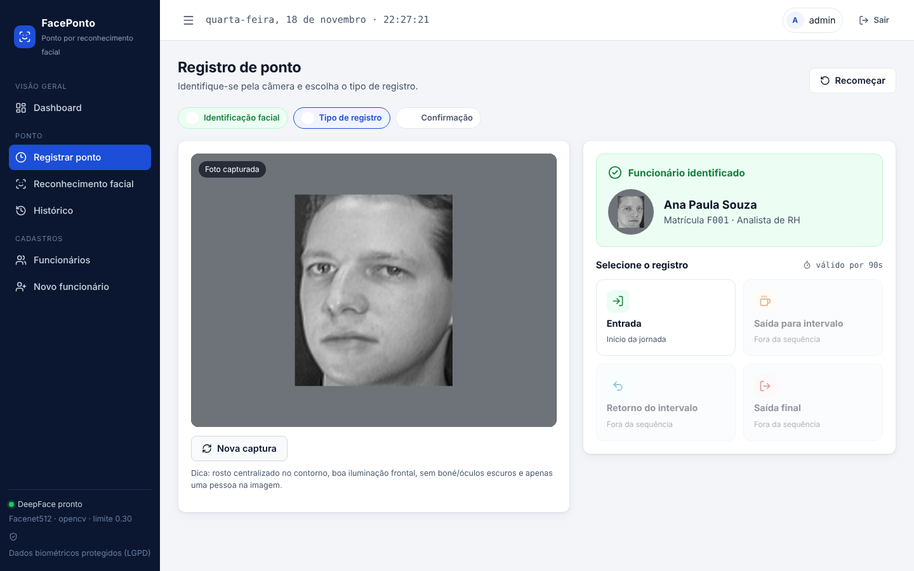

# FacePonto — Sistema de Registro de Ponto com Reconhecimento Facial

Projeto acadêmico completo: **React** (frontend) + **Python/FastAPI** (backend) + **SQLite** (banco) + **DeepFace** (reconhecimento facial), integrados por uma **API REST**.

Os funcionários registram **entrada, saída para intervalo, retorno do intervalo e saída final** olhando para a webcam. O sistema identifica a pessoa com o DeepFace (modelo **Facenet512**, distância do **cosseno**, limite **0,30**) e só libera o registro quando o rosto é válido e a identidade atinge o nível de confiança.



> Documentos complementares:
> - [`docs/capturas/`](docs/capturas/): capturas de tela das telas (dashboard, ponto, reconhecimento, histórico, mobile)
> - [`docs/APRESENTACAO.md`](docs/APRESENTACAO.md): arquitetura, tecnologias, DeepFace, fluxos, banco e roteiro para apresentar ao professor
> - [`docs/TESTES.md`](docs/TESTES.md): relatório dos testes que foram executados de fato, com os resultados
> - [`docs/LGPD.md`](docs/LGPD.md): consentimento e proteção dos dados biométricos

---

## Sumário
1. [Funcionalidades](#1-funcionalidades)
2. [Estrutura de pastas](#2-estrutura-de-pastas)
3. [Requisitos](#3-requisitos)
4. [Instalação no Windows 10/11 (passo a passo)](#4-instalação-no-windows-1011-passo-a-passo)
5. [Executando o sistema](#5-executando-o-sistema)
6. [Primeiro uso (roteiro rápido)](#6-primeiro-uso-roteiro-rápido)
6.1 [Reconhecimento por foto e pelo celular](#61-reconhecimento-por-foto-e-pelo-celular)
7. [Endpoints da API](#7-endpoints-da-api)
8. [Configurações (.env)](#8-configurações-env)
9. [Testes automatizados](#9-testes-automatizados)
10. [Solução de problemas](#10-solução-de-problemas)

---

## 1. Funcionalidades

| Módulo | O que faz |
|---|---|
| **Login** | Acesso por administrador (token JWT); todos os endpoints de dados são protegidos |
| **Dashboard** | Indicadores (funcionários, registros totais e de hoje, quem está trabalhando ou em intervalo), gráfico dos últimos 7 dias e últimos registros |
| **Funcionários** | Cadastro (nome completo, matrícula, cargo, foto pela webcam, data de cadastro automática), listagem com busca, consulta, edição (com troca opcional da foto) e exclusão |
| **Reconhecimento facial** | Captura pela webcam, envio ao backend, detecção e comparação com DeepFace; mostra distância, limite e confiança |
| **Foto enviada e celular** | Botão **Enviar foto** (galeria ou arquivo JPG/PNG), botão **Tirar foto** (câmera nativa do celular) e **modo celular** com câmera ao vivo por HTTPS na rede Wi-Fi, com troca entre câmera frontal e traseira. Registros feitos por foto enviada ficam marcados como "Foto enviada" no histórico |
| **Registro de ponto** | Identificação facial e escolha entre os 4 tipos; só os tipos válidos na sequência ficam habilitados; confirmação com nome, matrícula, data, horário e tipo |
| **Histórico** | Filtros por funcionário, matrícula, tipo e período; paginação; exportação CSV; espelho de ponto individual na ficha do funcionário |

**Validações do reconhecimento:** sem rosto, vários rostos, imagem escura, imagem estourada, imagem desfocada, rosto muito distante, funcionário não cadastrado, resultado ambíguo (dois cadastros muito parecidos), formato ou tamanho inválido.

**Validações do ponto:** sequência `ENTRADA → (SAÍDA INTERVALO → RETORNO) → SAÍDA FINAL`; cada tipo só uma vez por dia (regra na aplicação **e** `UNIQUE` no banco); intervalo mínimo de 60 s entre marcações; nada é aceito após a saída final; o registro exige um **token de reconhecimento** de uso único, válido por 90 s.

---

## 2. Estrutura de pastas

```
sistema-ponto-facial/
├── README.md                     ← este arquivo
├── iniciar_sistema.bat           ← abre backend + frontend + navegador (Windows)
├── docs/
│   ├── APRESENTACAO.md           ← material para a apresentação acadêmica
│   ├── TESTES.md                 ← relatório de testes executados
│   └── LGPD.md                   ← proteção de dados biométricos
├── backend/
│   ├── app/
│   │   ├── main.py               ← API FastAPI (todos os endpoints)
│   │   ├── config.py             ← configurações (lidas do .env)
│   │   ├── database.py           ← conexão SQLite (SQLAlchemy)
│   │   ├── models.py             ← tabelas funcionarios e registros_ponto
│   │   ├── schemas.py            ← validação de dados (Pydantic)
│   │   ├── recognition.py        ← reconhecimento facial com DeepFace
│   │   ├── ponto.py              ← regras de sequência e anti-duplicidade
│   │   ├── security.py           ← login JWT, token de reconhecimento, limite de tentativas
│   │   └── storage.py            ← armazenamento seguro das fotografias
│   ├── tests/
│   │   ├── test_api.py           ← 22 testes de ponta a ponta com DeepFace real
│   │   └── fixtures/             ← imagens de teste (AT&T Database of Faces)
│   ├── data/                     ← ponto.db (criado automaticamente)
│   ├── uploads/fotos/            ← fotografias (nome aleatório, não públicas)
│   ├── requirements.txt
│   ├── .env.example
│   ├── pytest.ini
│   ├── instalar_backend.bat
│   └── iniciar_backend.bat
└── frontend/
    ├── index.html
    ├── package.json
    ├── vite.config.js            ← proxy /api → backend (porta 8000)
    ├── iniciar_frontend.bat
    ├── iniciar_celular.bat       ← modo celular (HTTPS na rede Wi-Fi)
    ├── public/favicon.svg
    └── src/
        ├── main.jsx, App.jsx     ← rotas
        ├── services/api.js       ← cliente REST
        ├── services/AuthContext.jsx
        ├── components/           ← Layout (menu lateral), Webcam, Toast, UI
        ├── pages/                ← Login, Dashboard, Funcionarios, CadastroFuncionario,
        │                            FuncionarioDetalhe, Reconhecimento, RegistroPonto, Historico
        └── styles/global.css
```

---

## 3. Requisitos

| Software | Versão | Observação |
|---|---|---|
| Windows | 10 ou 11, **64 bits** | |
| **Python** | **3.12** (recomendado) ou 3.13, 64 bits | ⚠️ Não use 3.14: o TensorFlow ainda não tem pacote para ela. O NumPy instalado exige 3.12 ou superior. |
| **Node.js** | **22 LTS** ou superior (mínimo 20.19) | Necessário para o React/Vite |
| Navegador | Chrome ou Edge atualizados | Precisa permitir a câmera |
| Webcam | Qualquer webcam USB ou integrada | |
| Internet | Só na instalação | Baixa pacotes e os pesos do modelo (cerca de 95 MB) |
| Disco | Cerca de 3 GB livres | O TensorFlow é grande |

---

## 4. Instalação no Windows 10/11 (passo a passo)

> Os comandos abaixo são para o **Prompt de Comando (cmd)**. No PowerShell, veja a observação do passo 4.4.

### 4.1 Instalar o Python 3.12
1. Baixe em <https://www.python.org/downloads/windows/>: "Windows installer (64-bit)" da versão **3.12.x**.
2. Na primeira tela do instalador, **marque "Add python.exe to PATH"** e clique em *Install Now*.
3. Ao final, clique em **"Disable path length limit"**, se a opção aparecer. Isso evita erros ao instalar o TensorFlow.
4. Confira em um **novo** Prompt de Comando:
   ```bat
   python --version
   py -3.12 --version
   ```

### 4.2 Instalar o Microsoft Visual C++ Redistributable
O TensorFlow precisa dele no Windows. Baixe e instale o **"Visual C++ Redistributable x64"** em <https://aka.ms/vs/17/release/vc_redist.x64.exe>.

### 4.3 Instalar o Node.js (para o React)
1. Baixe a versão **LTS** em <https://nodejs.org/> e instale com as opções padrão.
2. Confira em um **novo** Prompt de Comando:
   ```bat
   node --version
   npm --version
   ```

### 4.4 Instalar o backend (Python + FastAPI + DeepFace)

**Opção A, automática:** dê dois cliques em `backend\instalar_backend.bat`. O script cria o ambiente virtual, instala tudo, cria o banco e baixa os pesos do modelo.

**Opção B, manual (mostra cada etapa):**
```bat
cd caminho\para\sistema-ponto-facial\backend

:: 1) Criar e ativar o ambiente virtual
py -3.12 -m venv venv
venv\Scripts\activate

:: 2) Atualizar o pip e instalar as dependências (FastAPI, SQLAlchemy, DeepFace, TensorFlow...)
python -m pip install --upgrade pip
pip install -r requirements.txt

:: 3) Criar o arquivo de configuração
copy .env.example .env

:: 4) Criar o banco de dados SQLite (data\ponto.db)
python -c "from app.database import criar_tabelas; criar_tabelas(); print('Banco criado')"

:: 5) Baixar e testar o modelo do DeepFace (Facenet512, cerca de 95 MB, só na primeira vez)
python -c "from app import recognition; recognition.carregar_modelo(); print(recognition.status_modelo())"
```
A última linha deve mostrar `'pronto': True`.

> **PowerShell:** se `venv\Scripts\activate` der erro de "execução de scripts desabilitada", rode uma vez
> `Set-ExecutionPolicy -Scope CurrentUser RemoteSigned` e depois `.\venv\Scripts\Activate.ps1`.

**Sobre o banco de dados:** não é preciso instalar nada. O SQLite já vem com o Python. As tabelas são criadas automaticamente no passo 4 e também sempre que a API inicia. O arquivo fica em `backend\data\ponto.db`. Para "zerar" o sistema, pare a API e apague `data\ponto.db` e as fotos em `uploads\fotos\`.

### 4.5 Instalar o frontend (React)
```bat
cd caminho\para\sistema-ponto-facial\frontend
npm install
```

---

## 5. Executando o sistema

São **dois terminais**: um para o backend e um para o frontend. Também é possível dar dois cliques em `iniciar_sistema.bat`, que abre os dois e o navegador.

**Terminal 1, backend (API na porta 8000):**
```bat
cd caminho\para\sistema-ponto-facial\backend
venv\Scripts\activate
python -m uvicorn app.main:app --host 127.0.0.1 --port 8000
```
Aguarde a mensagem `Modelo Facenet512 pronto` no log. A documentação interativa da API fica em <http://localhost:8000/docs>.

**Terminal 2, frontend (React na porta 5173):**
```bat
cd caminho\para\sistema-ponto-facial\frontend
npm run dev
```

**Acesse no navegador:** <http://localhost:5173>
- Usuário: `admin`
- Senha: `admin123` (altere em `backend\.env` → `ADMIN_PASSWORD`)

> Use **`localhost`**, e não o IP da máquina. Os navegadores só liberam a câmera em `https://` ou em `http://localhost`.

---

## 6. Primeiro uso (roteiro rápido)

1. **Novo funcionário** → preencha nome completo, matrícula e cargo → **Capturar foto** → marque o consentimento LGPD → **Cadastrar**.
2. **Reconhecimento facial** → **Reconhecer rosto**: aparece o funcionário, a distância (ex.: 0,15) e o limite (0,30).
3. **Registrar ponto** → **Reconhecer e registrar** → escolha **Entrada**.
4. Repita para **Saída para intervalo**, **Retorno do intervalo** e **Saída final**. Por padrão é preciso aguardar 60 s entre marcações. Para a demonstração em sala, você pode definir `INTERVALO_MINIMO_SEGUNDOS=5` no `.env`.
5. **Histórico** → filtre por data, matrícula ou tipo, ou exporte em CSV.
6. **Dashboard** → veja os indicadores atualizados.

### 6.1 Reconhecimento por foto e pelo celular

Há três formas de enviar o rosto, disponíveis nas telas de **Cadastro**, **Reconhecimento** e **Registro de ponto**:

| Forma | Como usar | Precisa de HTTPS? |
|---|---|---|
| **Câmera ao vivo** | Botão "Reconhecer…/Capturar" | Só fora do `localhost` (no celular, sim) |
| **Enviar foto** | Escolhe uma foto da galeria do celular ou um arquivo JPG/PNG do computador | Não |
| **Tirar foto** (aparece no celular) | Abre a câmera nativa do celular, tira a foto e envia | Não |

A foto escolhida é girada automaticamente conforme o EXIF (fotos de celular "deitadas"), reduzida para no máximo 1280 px e convertida em JPEG antes do envio. O backend aplica as mesmas validações da câmera: um rosto, iluminação, nitidez etc.

#### Opção A: celular sem configurar nada (Tirar foto / Enviar foto)
1. Inicie o backend normalmente (Terminal 1).
2. No Terminal 2, rode o frontend liberado na rede: `npx vite --host`.
3. Descubra o IP do computador com `ipconfig` (linha "Endereço IPv4", ex.: `192.168.0.10`).
4. No celular, **na mesma rede Wi-Fi**, abra `http://192.168.0.10:5173` e faça login.
5. Em **Registrar ponto**, toque em **Tirar foto**. A câmera do celular abre; tire a selfie e confirme.

> A câmera **ao vivo** não aparece nesse modo, porque os navegadores bloqueiam a câmera em páginas `http://` que não são `localhost`. O sistema mostra esse aviso e oferece "Tirar foto".

#### Opção B: câmera ao vivo no celular (modo celular com HTTPS)
1. Inicie o backend normalmente (Terminal 1).
2. No Terminal 2:
   ```bat
   cd frontend
   npm run celular
   ```
   (ou dois cliques em `frontend\iniciar_celular.bat`). O Vite mostra algo como:
   ```
   ➜  Local:   https://localhost:5173/
   ➜  Network: https://192.168.0.10:5173/
   ```
3. Se o Windows perguntar, **permita o Node.js no Firewall** (marque "Redes privadas").
4. No celular, na mesma rede Wi-Fi, abra o endereço **Network** (`https://192.168.0.10:5173`).
5. Aparece o aviso "Sua conexão não é particular": o certificado é gerado localmente para a demonstração. Toque em **Avançado → Continuar para o site** (no iPhone: **Mostrar detalhes → visitar este site**).
6. Faça login e permita o acesso à câmera. A câmera ao vivo funciona, e o botão no canto da imagem troca entre a câmera **frontal e a traseira**.

> O backend continua rodando só no computador (`127.0.0.1:8000`). O celular fala apenas com o Vite, que repassa as chamadas `/api` para o backend. Por isso não é preciso abrir a porta 8000 na rede.

#### Segurança da foto enviada
Reconhecer a partir de uma foto é prático, mas permite que alguém use **uma foto de outra pessoa** (por exemplo, tirada da tela de outro celular). Por isso:
- cada registro guarda a **origem** (`camera` ou `arquivo`), exibida no histórico como **"Foto enviada"** e exportada no CSV;
- o envio de foto para reconhecimento pode ser **desligado** no `backend\.env` com `PERMITIR_FOTO_ARQUIVO=false`. Os botões somem e a API passa a recusar (403). O cadastro por foto enviada continua permitido, pois é feito pelo administrador.

A origem é informada pelo navegador, então serve para **auditoria**, e não como prova contra fraude. A proteção real contra fotos é a detecção de vivacidade (*anti-spoofing*), proposta como melhoria futura em `docs/APRESENTACAO.md`.

---

## 7. Endpoints da API

Todos exigem `Authorization: Bearer <token>`, exceto `/api/status` e `/api/auth/login`.

| Método | Rota | Descrição |
|---|---|---|
| GET | `/api/status` | Status da API e do modelo DeepFace |
| POST | `/api/auth/login` | Login do administrador → token JWT |
| GET | `/api/dashboard` | Indicadores do dashboard |
| POST | `/api/funcionarios` | **Cadastrar** funcionário (dados + foto base64) |
| GET | `/api/funcionarios?busca=` | **Listar** funcionários |
| GET | `/api/funcionarios/{id}` | **Consultar** funcionário |
| PUT | `/api/funcionarios/{id}` | **Atualizar** funcionário (foto opcional) |
| DELETE | `/api/funcionarios/{id}` | **Excluir** funcionário (foto, biometria e registros) |
| GET | `/api/funcionarios/{id}/foto` | Foto (somente autenticado) |
| GET | `/api/funcionarios/{id}/registros` | **Registros por funcionário** |
| POST | `/api/reconhecimento` | **Reconhecimento facial** (`imagem` + `origem`: `camera` ou `arquivo`) → funcionário + token de registro |
| POST | `/api/ponto` | **Registrar ponto** (`token_registro` + `tipo`) |
| GET | `/api/registros` | **Histórico** com filtros `funcionario_id`, `matricula`, `tipo`, `data_inicio`, `data_fim`, `pagina`, `limite` |
| GET | `/api/registros/exportar` | Histórico em CSV |

Erros seguem o formato `{"detail": "mensagem em português", "codigo": "SEM_ROSTO"}`.

---

## 8. Configurações (.env)

| Variável | Padrão | Significado |
|---|---|---|
| `SECRET_KEY` | (troque) | Chave que assina os tokens JWT |
| `ADMIN_USERNAME` / `ADMIN_PASSWORD` | admin / admin123 | Credenciais do administrador |
| `MODEL_NAME` | Facenet512 | Modelo do DeepFace (`VGG-Face`, `Facenet`, `ArcFace`...) |
| `DETECTOR_BACKEND` | opencv | Detector de rosto (`opencv`, `retinaface`, `mtcnn`, `ssd`) |
| `DISTANCE_METRIC` | cosine | Métrica (`cosine`, `euclidean`, `euclidean_l2`) |
| `DISTANCE_THRESHOLD` | (vazio = 0,30) | Limite de distância; quanto menor, mais rigoroso |
| `MARGEM_AMBIGUIDADE` | 0.05 | Recusa se o 2º cadastro mais parecido estiver a menos disso do 1º |
| `BRILHO_MINIMO` | 60 | Média de brilho mínima (0 a 255) |
| `NITIDEZ_MINIMA` | 25 | Nitidez mínima do rosto (variância do Laplaciano) |
| `INTERVALO_MINIMO_SEGUNDOS` | 60 | Tempo mínimo entre duas marcações |
| `PERMITIR_FOTO_ARQUIVO` | true | Permite reconhecer por foto enviada (galeria/arquivo). Use `false` para aceitar só a câmera ao vivo |

> Se trocar `MODEL_NAME`, **recadastre as fotos** (editar → capturar nova foto). Os vetores de modelos diferentes não são comparáveis, e o sistema ignora cadastros feitos com outro modelo.

---

## 9. Testes automatizados

```bat
cd backend
venv\Scripts\activate
python -m pytest -v
```
São 22 testes que usam o **DeepFace real**, sem simulação. Eles cobrem cadastro, armazenamento da foto, reconhecimento, recusa de não cadastrado, imagens ruins (sem rosto, dois rostos, escura, desfocada), a sequência completa de ponto, duplicidades, tokens, histórico, filtros, edição, exclusão e persistência. Os testes usam um banco temporário e não tocam nos seus dados. O resultado da última execução está em [`docs/TESTES.md`](docs/TESTES.md).

---

## 10. Solução de problemas

| Problema | Solução |
|---|---|
| `'python' não é reconhecido...` | Reinstale o Python marcando **Add to PATH**, ou use `py -3.12` no lugar de `python`. |
| `ERROR: No matching distribution found for tensorflow==2.21.0` | O Python é 32 bits ou é a versão 3.14. Instale o **Python 3.12 64 bits** e recrie o `venv`. |
| `OSError: [Errno 2] No such file or directory` com caminho longo durante o `pip install` | Habilite caminhos longos: execute o instalador do Python → *Modify* → "Disable path length limit", ou mova o projeto para `C:\ponto\`. |
| `ImportError: DLL load failed while importing _pywrap_tensorflow_internal` | Instale o **Visual C++ Redistributable x64** (passo 4.2) e reinicie o computador. |
| `No module named 'tf_keras'` ou erro de Keras 3 | `pip install tf-keras==2.21.0` |
| Falha ao baixar `facenet512_weights.h5` (firewall/proxy) | Baixe manualmente em <https://github.com/serengil/deepface_models/releases/download/v1.0/facenet512_weights.h5> e salve em `C:\Users\<seu_usuario>\.deepface\weights\facenet512_weights.h5`. |
| Primeira requisição muito lenta | Normal: o TensorFlow carrega o modelo. A API já "aquece" o modelo na inicialização. Aguarde "DeepFace pronto" no menu lateral. |
| `venv\Scripts\activate` bloqueado no PowerShell | `Set-ExecutionPolicy -Scope CurrentUser RemoteSigned` |
| `npm` não reconhecido | Reinstale o Node.js LTS e abra um **novo** terminal. |
| Erro do Vite sobre versão do Node | Atualize o Node.js para 22 LTS ou superior. |
| `Port 5173 is in use` / `[Errno 10048]` (porta 8000) | Feche a outra janela que está usando a porta, ou encerre o processo: `netstat -ano \| findstr :8000` e depois `taskkill /PID <pid> /F`. |
| Tela mostra "API offline" / "Não foi possível conectar ao servidor" | O backend não está rodando na porta 8000. Inicie o Terminal 1. |
| "Permissão da câmera negada" | Clique no ícone de câmera na barra de endereço → Permitir. No Windows: Configurações → Privacidade → Câmera → permitir apps da área de trabalho. |
| "A câmera está sendo usada por outro programa" | Feche Teams, Zoom, OBS ou outros apps que usam a câmera. |
| Sempre "Nenhum rosto foi detectado" | Melhore a luz frontal e aproxime o rosto. Como alternativa, use `DETECTOR_BACKEND=retinaface` (mais preciso; baixa outro modelo na 1ª vez). |
| "Imagem desfocada" com frequência | Webcam de baixa qualidade: reduza `NITIDEZ_MINIMA` para 15 no `.env`. |
| Funcionário cadastrado não é reconhecido | Recadastre a foto com boa iluminação e de frente. Se necessário, aumente `DISTANCE_THRESHOLD` para 0.35. Aumentar demais o limite eleva o risco de confundir pessoas. |
| Celular não abre `https://192.168...:5173` | Confirme que o celular está no **mesmo Wi-Fi** (não no 4G/5G), que usou `npm run celular` e que o Node.js foi liberado no Firewall do Windows (Painel de Controle → Firewall → Permitir um aplicativo → Node.js → Privada). Redes de faculdade às vezes isolam os aparelhos entre si: nesse caso, use o roteador do seu celular como hotspot para o notebook. |
| No celular aparece "a câmera ao vivo só funciona com HTTPS" | Você abriu por `http://`. Use `npm run celular` e o endereço `https://`, ou use o botão **Tirar foto**. |
| Foto enviada recusada como "desfocada" ou "muito escura" | Tire outra foto com mais luz e o celular parado. Fotos de tela (print) costumam falhar. |
| Botões "Enviar foto"/"Tirar foto" não aparecem no reconhecimento | `PERMITIR_FOTO_ARQUIVO=false` no `.env`. Mude para `true` e reinicie o backend. |
| Erro 401 / volta para o login | Sessão expirou (8 h): entre novamente. |
